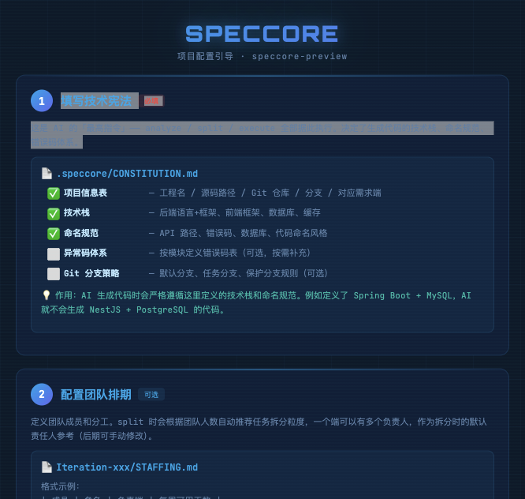
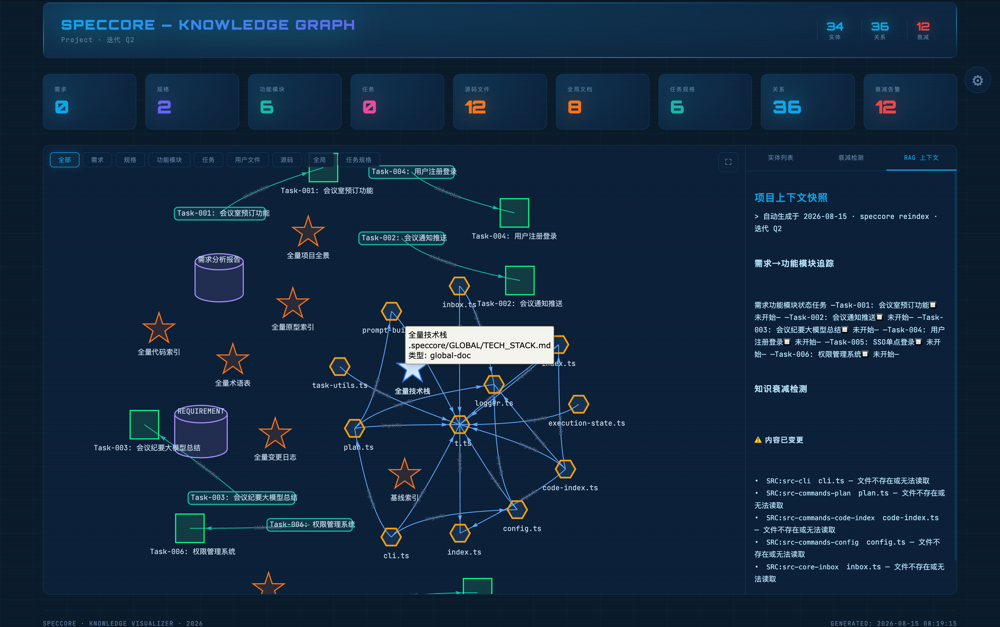
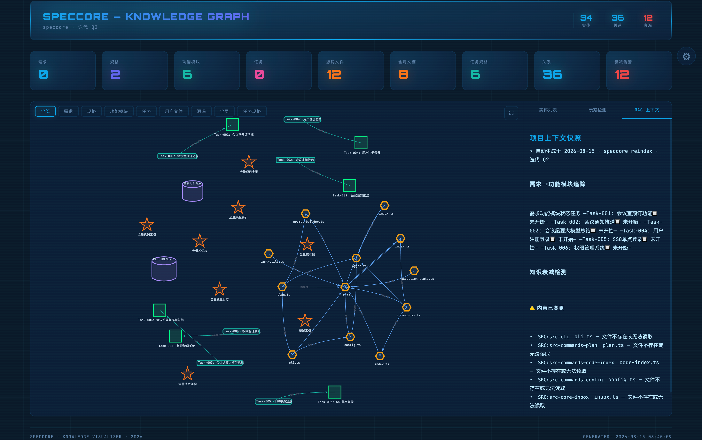

# SpecCore — Code by Spec, Not by Vibe

**SpecCore is not a code generator — it's a human-AI collaboration operating system.** It turns requirements, splitting, planning, execution, and delivery into a closed loop — every step previewable and adjustable, ensuring human and AI reach consensus before a single line of code is written.

> Juggling 5 microservices and 3 frontend platforms? SpecCore turns requirements → splits → plans → code → delivery into a traceable, automated pipeline.

```
  init → doc2spec → analyze(overview) → analyze(units) → split → plan → execute → pr → done → spec2doc
  🚀Setup   📝Import   🧠Analyze   🧠Analyze   📦Split  📋Plan  💻Build  🔀PR  ✅Archive  📤Export
  ✅ CLI    🔒 AI      🔒 AI       🔒 AI       🔒 AI     🔒 AI    🔒 AI    🔒 AI  🔒 AI      🔒 AI
```

## 🚀 5 Minutes to First Task

```bash
# CLI usage (direct terminal commands)
npm install -g speccore
speccore init
speccore iteration create -n Q1     # Create iteration

# 🔒 AI usage (in WorkBuddy/Cursor/Trae via @spec-ask)
@spec-ask "import requirements.docx to Q1 iteration"
@spec-ask "analyze Q1 requirements and code health"
@spec-ask "taskify Q1 iteration into tasks"
@spec-ask "generate execution plan for Q1"
@spec-ask "execute Task-001 with AI"
@spec-ask "archive Task-001 after validation"
```

**📋 Setup Guide** — `speccore init` auto-generates a 6-step onboarding guide:



## 🧠 Knowledge Graph Visualization

`speccore knowledge` generates an interactive HTML knowledge graph with 8 shape types for entity distinction and automatic decay detection:

**Full View (Large Nodes)**



**Zoomed View (Compact Layout)**



## 🎯 What do you want to do?

| I want to... | Command |
|:---|:---|
| **Start a new project** | `speccore init --interactive` |
| **Import a PRD document** | `@spec-ask "import PRD.docx to Q1"` 🔒 |
| **Analyze requirements + code health** | `@spec-ask "analyze Q1 requirements"` 🔒 |
| **Split requirements into tasks** | `speccore iteration taskify -I Q1 --interactive` |
| **Fix a bug** | `speccore task new -n "Login timeout" --type=bugfix` |
| **Batch fix bugs** | `speccore task new --batch-file=bugs.xlsx --type=bugfix` |
| **Refresh retrieval layers** | `speccore refresh` |
| **AI auto-development** | `@spec-ask "execute Task-001"` 🔒 |
| **Create a Pull Request** | `@spec-ask "create PR for Task-001"` 🔒 |
| **Archive a completed task** | `@spec-ask "archive Task-001"` 🔒 |
| **Check project status** | `speccore` or `speccore dashboard` |
| **Natural language queries** | `@spec-ask "analyze current requirements"` 🔒 |

> 📋 Full command reference → [Command Reference](docs/commands.en.md) | 中文文档 → [README.zh.md](README.md)

## 🤝 Interactive Mode

6 commands support `--interactive` — preview changes before confirming:

| `🧠 analyze --interactive` | `🧠 split --interactive` | `🧠 plan --interactive` |
|:---|:---|:---|
| `🧠 pr --interactive` | `🧠 change --interactive` | `🧠 done --interactive` |

## 🔄 Unified Retrieval Refresh

```bash
speccore refresh                    # Refresh all retrieval layers (code index + RAG + knowledge graph)
speccore refresh --code             # Only code index
speccore refresh --rag              # Only document RAG
speccore refresh --graph            # Only knowledge graph
```

## 📚 Documentation

| Doc | Content |
|:---|:---|
| 🚀 [Quick Start](docs/quick-start.en.md) | Full tutorial |
| 🔧 [Command Reference](docs/commands.en.md) | Full command reference |
| 🎬 [Scenarios](docs/scenarios.en.md) | Real-world examples |
| 🗺 [Overview](docs/overview.md) | Architecture & philosophy |
| 📝 [SDD Methodology](docs/sdd-methodology.en.md) | Spec-driven development |
