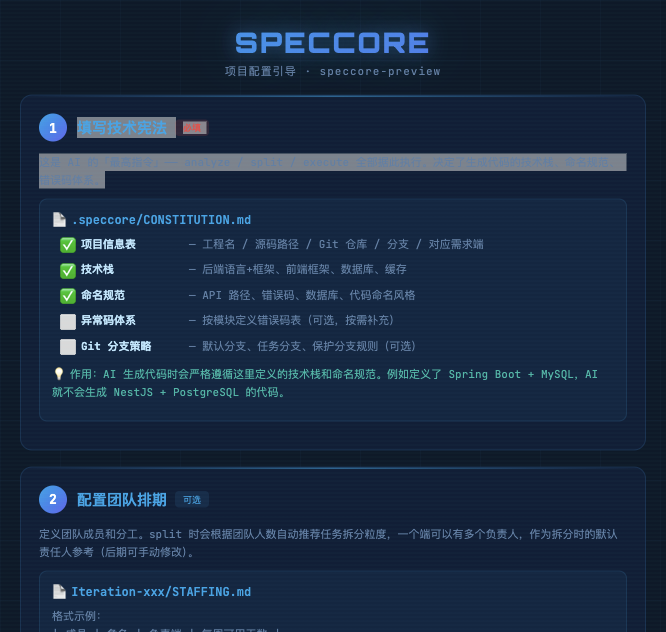

# SpecCore — Code by Spec, Not by Vibe

[](https://www.npmjs.com/package/speccore) [](https://www.npmjs.com/package/speccore) [](https://skills.sh/windfallsheng/SpecCore-ts)

🖥️ 规范驱动开发 CLI · 需求到部署全流程 · 环境驱动部署 · 全命令 Skill 覆盖 · 多层 AI 架构

> English: A spec-driven development CLI for AI coding agents — from requirements to deployable code, end to end, with specs as the single source of truth.

SpecCore 把「需求文档」一路规范驱动到「可交付代码」：导入需求 → 切分功能单元 → 分析 → 拆分任务 → 开发 → 验证 → 部署。整个过程由规格（Spec）驱动，AI 只在需要判断和生成的地方介入，关键动作留给你确认。

上游需求定稿用 [SpecProt](https://github.com/windfallsheng/SpecProt-CLI)，下游测试验证用 [SpecTest](https://github.com/windfallsheng/SpecTest-CLI)——Spec\* 生态三件套各管一段：定稿 → 开发 → 测试。

---

## 快速开始

```bash
npm install -g speccore
speccore init                        # 初始化项目，生成配置引导
```

四步走完一个迭代：

| 步骤 | 命令 | 说明 |
|------|------|------|
| ① 导入需求 | `speccore doc2spec -f PRD.docx` | 源文档转 MD，按需切分功能单元 |
| ② 分析 | `speccore analyze` | AI 生成技术规格（Spec） |
| ③ 开发 | `speccore execute` | 按计划开发代码 |
| ④ 交付 | `speccore pr` | 总结变更 + 提交 |

> 💡 **不想记命令？** 用自然语言入口 `speccore ask "我想做一个支付功能"`，AI 自动编排流水线。或在 AI IDE 中通过 `@spec-ask` 直接对话。

---

## 核心流水线

一条 `run` 命令覆盖全流程，用**预设流水线（preset）**按场景起停：

```bash
speccore run --preset develop   # 分析→验证（默认）
speccore run --preset spec      # 导入需求→拆分任务（生成 Spec 看效果）
speccore run --preset deploy    # 分析→部署验证
speccore run --preset deliver   # 执行→提交代码
speccore run                    # 无参 = 智能续跑（v8.3.290+）：检测断点，从第一个未完成阶段继续
```

### 快捷语法糖（v8.3.290+，不依赖 ask 引擎）

```bash
speccore run develop            # preset 直呼
speccore run smoke              # 单阶段快捷：从验证跑到部署（别名: split/smoke/code/tasks/ship/…）
speccore run split-units to execute   # 范围（自然语言式）
speccore run split-units..execute     # 范围（紧凑式）
speccore run "做用户积分功能"   # 一句话需求，从需求出发全流程
speccore analyze -g             # 快捷糖：等价 speccore global analyze
speccore unitize prd.md         # 文件位置参数：等价 unitize --file prd.md
speccore verify deploy          # 测试阶段位置参数：等价 verify --stage deploy
```

### 8 个预设流水线

| preset | 起止 | 场景 |
|---|---|---|
| `develop` | analyze → verify | 分析→验证（**默认**，代码+验证完成） |
| `full` | req-doc → spec2doc | 全流程（含收尾） |
| `import` | doc2spec → pr | 导入需求→合并请求 |
| `spec` | doc2spec → taskify | 导入需求→拆分任务 |
| `analyze` | analyze → validate | 只分析校验 |
| `deliver` | execute → pr | 执行→提交代码 |
| `deploy` | analyze → pipeline | 分析→部署验证 |
| `docs` | analyze → spec2doc | 分析→文档导出 |

### 精确控制起止点

```bash
speccore run --from split-units --to execute   # 从切分功能单元到开发
speccore run --from taskify --to pr            # 从拆分任务到提交
```

### 流水线阶段全景

```
需求入口（二选一）     结构化          质量提升（可选）
req-doc ──┐
          ├─→ split-units ──→ 澄清(auto/on/off)
doc2spec ─┘                        │
                                   ▼
analyze → validate → taskify → plan → execute → verify
                                                │
               ┌────────────┬──────────┬────────┴─────────┐
               ▼            ▼          ▼                  ▼
           pipeline      pr(提交)    done(归档)        spec2doc(导出)
           (部署)         （独立收尾，按需调用）
```

**三个闸口**（全自动时停下来等你确认）：Spec 定稿 → 代码 review → 部署前确认。

### 自定义 + 默认流水线

在 `.speccore.yml` 里定义自己的命名流水线，并设置默认：

```yaml
settings:
  pipelines:
    default: develop
    custom:
      hotfix: execute,verify,pipeline,pr
      quick: analyze,taskify,execute
```

### 可配置步骤（三态开关）

非必要步骤支持 `auto / on / off` 三态，配置默认行为，也可命令/自然语言单次覆盖：

```yaml
settings:
  optional_steps:
    clarify: auto     # 需求澄清：auto=按专业度判定 / on=强制 / off=跳过
    verify: auto      # 验证
    pipeline: auto    # 部署
    pr: auto          # 提交
    done: auto        # 归档
    spec2doc: auto    # 导出文档
```

跳过澄清时，仍会生成**需求质量审查报告**（`010-requirements/QUALITY_REPORT.md`），列出每份文档的问题清单和具体修正命令。

---

## 常用命令

记不住命令？高频就这几个：

| 命令 | 作用 |
|------|------|
| `run` | 命名流水线入口（preset / 起止点） |
| `ask` | 自然语言入口（说人话，自动编排） |
| `doc2spec` | 导入 PRD → SpecCore MD |
| `unitize` | 切分需求文档 → 功能单元（原 doc2spec --split） |
| `req-doc` | 一句话需求 → PRD 文档 |
| `analyze` | AI 需求分析 |
| `taskify` | 拆分需求为开发任务 |
| `execute` | 按计划开发 |
| `pr` | 总结变更 + 提交代码 |
| `spec2doc` | 导出 Word/PDF/HTML |
| `status` | 查看进度 |

> 完整命令见 [命令参考](docs/command-reference.md)，或 `speccore help` 查看分类；全部命令（含低频/运维/内部编排）用 `speccore help --all`。

---

## 核心能力

### 🧠 自然语言入口

`speccore ask "..."` 四模式：命令解释 / 任务指引 / 意图匹配 / 复杂编排。口语即可，无需记忆命令：

```bash
speccore ask "帮我部署"                    # → run --preset deploy
speccore ask "从分析到开发"                # → run --from analyze --to execute
speccore ask "分析本迭代需求，跳过澄清"     # → analyze --skip-clarify
```

### ⚡ spec-once 单会话端到端

一句「spec once」把需求到部署整条链装进一次会话：需求入口（功能单元 / 文档地址 / 一句话需求）→ 澄清 → 分析 → 拆分任务 → 开发 → 本地冒烟 → 部署验证。**双模式**：默认人机交互（每个节点停下确认），说「全自动/别停」切全自动（仅范围确认、质量门禁失败、冒烟失败三个安全点停下）。哪一步不满意可**回退重跑**：重分析（`analyze --unit` 覆盖+备份）、重拆（`taskify --modules`）、重执行（`execute` 单任务）、重切（`unitize --on-duplicate`）。适合少量功能单元（≤3）的快速闭环，大范围走 `speccore run` 流水线。

### 📊 仪表盘

`speccore dashboard` 生成 Jira 标准 7 维度看板（需求状态 / 项目健康度 / 进度条）。

### 🚀 环境驱动部署

`speccore pipeline` 五层环境模型（local → dev → test → staging → production）：

```bash
speccore pipeline --env staging --all      # 一键 merge → build → deploy
speccore pipeline --env test --platforms h5,api
```

### 🧪 质量验证

`speccore verify` 分层测试：编译 + Lint + 单元测试 + UI 冒烟 + API 契约 + 性能基线。部署前可阻断，部署后只报告。

```bash
speccore verify --stage pr                 # PR 阶段：代码质量 + 冒烟 + 契约
speccore verify -t Task-001 --ui           # 单任务 UI 冒烟
```

**冒烟测试三时机 × 范围**（v8.3.217+）：开发完成后自动「本地冒烟 → 提交 → 部署前冒烟 → 部署 → 环境冒烟」，范围可按环境差异化（全量 / 当前功能模块），支持登录账号自动装配：

```bash
speccore run --preset develop              # 开发完自动本地冒烟
speccore run --preset deploy --env staging # 部署 + 环境冒烟
speccore run --scope full                  # 单次指定全量
speccore run --skip-smoke                  # 单次跳过冒烟
```

登录账号在 `.speccore/environments/*.yaml` 的 `tests.auth` 配置，冒烟前自动装配（密码走 `SMOKE_PASSWORD` 环境变量，不落库）；三时机开关与范围在 `.speccore.yml` 的 `settings.smoke` 配置。详见 [测试指南](docs/testing-guide.md)。

**冒烟装配四阶段闭环**（v8.3.293+）：分析定契约（UI_SPEC 元素标识约定 `{模块}-{页面}-{元素}`）→ 拆分装配 selector（taskify 无源码时从 UI_SPEC 提取元素清单 + stateDiagram/流程步骤，自动生成 VERIFY_SPEC 场景）→ 执行落属性（代码生成强制写 data-testid）→ 冒烟自愈提示（失败场景汇总页面实际 data-testid 清单供修正）。UI 元素与测试断言从分析到运行环环相扣，不再靠人肉对配置。

### 📖 配置引导

`speccore init` 后自动生成 6 步引导页，帮助新用户快速上手。



---

## 核心命令（分类）

| 分类 | 命令 |
|------|------|
| 初始化 / 导入 | `init` `doc2spec` `req-doc` |
| 迭代 / 任务 | `iteration` `task` |
| 分析 / 计划 | `analyze` `plan` |
| 切分 / 导出 | `unitize` `spec2doc` |
| 执行 / 交付 | `execute` `verify` `pipeline` `pr` `done` |
| 智能入口 | `ask` `run` `next` `dashboard` `status` `about` `help` |

> 🔧 低频/运维/内部编排命令（`validate` `change` `sync` 等 29 个）不在面板展示但功能保留，完整清单见 `speccore help --all`。
> 💡 **全命令 Skill**：所有命令均支持 `/命令 + 自然语言` 快捷入口，如 `/deploy 部署到测试环境`、`/verify 跑冒烟测试`。

---

## 目录结构

```
Iteration-001-meeting/
├── 000-overview/               ← 进度跟踪
├── 010-requirements/           ← 需求文档（按功能组织）
│   ├── sources/                ← [只读] 原始 PRD/Word/PDF
│   ├── converted/              ← [自动生成] doc2spec 转换后的 MD
│   ├── features/               ← [手动维护] 切分后的功能单元
│   └── QUALITY_REPORT.md       ← [自动生成] 需求质量审查报告
├── 020-specs/                  ← analyze 输出（三层架构）
│   ├── overview/               ← 迭代级全局文档
│   ├── {feature}/              ← 功能模块目录
│   └── PLATFORMS.md            ← 端列表元数据
├── 030-tasks/                  ← taskify 开发任务
│   └── Task-001-*/
│       ├── 00-specs/           ← 执行前核心规格
│       ├── {platform}/         ← 各端实现
│       └── .issues.md          ← 问题追踪
└── STAFFING.md                 ← 人员排期
```

---

## 多层 AI 架构

```
@spec-ask "..."  (AI IDE 入口)
  ├─ 🧠 自有 LLM   → OpenAI / Ollama（SPECCORE_LLM_KEY 环境变量）
  ├─ 🤖 宿主 AI    → WorkBuddy / TRAE / Qoder（自动检测）
  ├─ 📐 规则引擎   → 命令 KB + 预定义工作流（永远可用）
  └─ 🎭 多 Subagent → 按阶段/端/模块分配专属角色（步骤隔离）
```

**零配置降级**：没配 Key 自动降级，功能不受影响。

---

## 📖 文档

| 文档 | 说明 |
|------|------|
| [快速开始](docs/quick-start.md) | 5 分钟上手：安装 → 完整流程 |
| [命令参考](docs/command-reference.md) | 全部命令 + 子命令 + 示例 |
| [总览](docs/overview.md) | 核心概念 + 工作流 + 三种使用方式 |
| [配置参考](docs/config-reference.md) | 全部配置项（含 pipelines / optional_steps） |
| [场景实战](docs/scenarios.md) | 30+ 个真实开发场景 |
| [SDD 方法论](docs/sdd-methodology.md) | 规范驱动开发理念 |
| [工作空间组织](docs/workspace-organization.md) | 目录结构与文件规范 |
| [文件编辑指南](docs/usage-guide.md) | 哪些文件能改、哪些用命令 |
| [速查表](docs/quick-reference.md) | 常用命令一页速查 |
| [三层加载机制](docs/spec-layers.md) | GLOBAL/迭代/TASK 加载原理 |
| [测试指南](docs/testing-guide.md) | 分层测试与质量验证 |
| [CI-CD 集成](docs/ci-cd-spec-integration.md) | CI/CD 流水线 + Spec 注释 |
| [工具适配](docs/tool-adapters.md) | Qoder/TRAE 等 AI 工具集成 |
| [架构设计](docs/ARCHITECTURE.md) | 系统架构 |
| [CHANGELOG](CHANGELOG.md) | 版本历史 |

**设计文档**（面向开发者/架构师）：

| 文档 | 说明 |
|------|------|
| [架构设计全集](docs/DESIGN.md) | 详细架构设计 |
| [知识库设计](docs/knowledge-base-design.md) | 知识图谱与 RAG 设计 |
| [Task 目录结构设计](docs/task-directory-design.md) | 任务目录规范 |
| [需求变更设计](docs/change-and-new-requirement-design.md) | 变更与新增需求交互 |
| [Pipeline 扩展示例](docs/pipeline-extension-example.md) | 流水线引擎扩展 |

---

## 许可

详见 LICENSE 文件。
