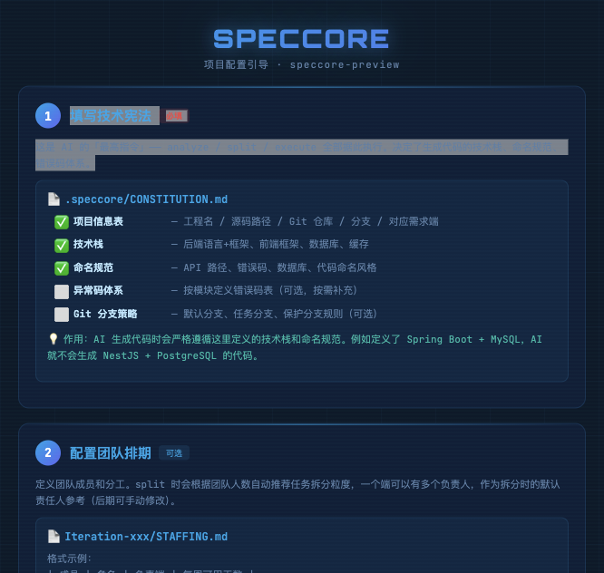

# 命令参考 (v8.3.346)

---
title: 命令参考
---

> 💡 **命令面收敛（v8.3.346+）**：终端 `speccore help` 面板只展示 22 个核心命令（13 阶段流水线 + 迭代/任务管理 + 智能入口）；本文档收录全部命令（含低频/运维/内部编排），最新完整清单见 `speccore help --all`。

## 命令分类

| 类型 | 说明 | 示例 |
|:---|:---|:---|
| 🔒 **AI 命令** | 需在 AI IDE（WorkBuddy/Cursor/Trae）中通过 `@spec-ask` 使用 | `doc2spec`, `analyze`, `plan`, `execute`, `pr`, `done` |
| ✅ **CLI 命令** | 可在终端直接输入 `speccore xxx` 执行 | `init`, `dashboard`, `validate`, `iteration create` |
| ⚡ **部署命令** | 支持环境驱动，通过 `--env` 读取环境配置 | `pipeline`, `build`, `deploy` |
| 🧪 **测试命令** | 支持配置驱动测试，通过 `--config` 加载测试场景 | `verify` |

> 💡 AI 命令在 AI IDE 中也可通过 `/spec-xxx` 快捷命令或 `@spec-ask "描述"` 自然语言方式使用。

## 总览

### 架构

```
speccore ask ←── 万能 AI 入口 ──→ speccore run
    │                                  │
    ├─ 📖 命令解释                      ├─ 初始化→导入→分析→任务化
    ├─ 🗺️ 任务指引                      ├─ 计划→执行→PR→归档
    ├─ 🎯 意图匹配                      └─ 命名流水线自动推进
    └─ ⚡ 复杂编排
```

### TTY 智能适配

| 环境 | ask | welcome | dev | dashboard |
|------|:--:|:--:|:--:|:--:|
| 终端 | Unicode 框线 | Unicode 框线 | 文本输出 | 文本输出 |
| AI 调用 | HTML 页面 | HTML 页面 | HTML 页面 | HTML 页面 |

---

## 核心命令 (21)

### 🧠 ask — 万能 AI 入口 🔒 AI 命令
```bash
speccore ask "<自然语言描述>"
```
四种模式自动识别: 📖命令解释 / 🗺️任务指引 / 🎯意图匹配 / ⚡复杂编排

**双模式确认**: 未说"自主/一键"→ 展示理解等确认；说了自主 → 确认后全自动执行

**使用示例**：
```bash
# AI 窗口中（推荐）：
直接说 "帮我分析登录需求"          # 自然语言，AI 自动路由
/spec-ask "执行 Task-001"             # 斜杠命令，显式触发

# 终端中：
speccore ask "拆分任务"              # 显式调用意图识别
speccore ask "查看进度"              # 匹配到 dashboard
```

> 💡 Skill（`.agents/skills/spec-ask/SKILL.md`）在 `init` 后自动加载，AI 已具备完整行为规则。
> `/spec-ask` 斜杠命令只是手动快捷入口，与自然语言效果相同。

### 🏷️ about — 版本信息
```bash
speccore about
```
生成 HTML 版本信息页：功能概览 + 近期亮点 + 里程碑 + 文档链接

### 🏷️ welcome — 项目名片
```bash
speccore welcome [--web] [--output <path>]
```
显示项目状态、流水线阶段、ask 使用引导

### 📊 dashboard — 仪表盘
```bash
speccore dashboard [--scope global|iteration] [--export html] [--health] [--lifecycle]
```
别名: `db`, `sp`

### 🔄 run — 命名流水线 🔒 AI 命令
```bash
speccore run [<preset名>] [<阶段/别名>] [<from> to <to> | <from>..<to>] [<一句话需求>]
speccore run [--preset <name>] [--from <phase>] [--to <phase>] [--demand <text>]
```
别名: `r`

**位置参数文法（v8.3.290+ 快捷语法糖，按序消歧）：**

| 输入形态 | 行为 | 示例 |
|:---|:---|:---|
| 无参 | 智能续跑：检测 9 个里程碑断点，从第一个未完成阶段继续（全完成时指路收尾） | `speccore run` |
| `<preset名>` | preset 直呼（优先于别名） | `speccore run develop` |
| `<阶段/别名>` | 单阶段快捷：从该阶段续跑至部署验证 | `speccore run smoke` |
| `<from> to <to>` | 阶段范围（自然语言式，首 token 不命中阶段则视为需求） | `speccore run split-units to execute` |
| `<from>..<to>` | 阶段范围（紧凑式） | `speccore run split-units..execute` |
| 其他多词 | 一句话需求（req-doc 阶段消费） | `speccore run "做用户积分功能"` |
| `--demand <text>` | 逃生舱：显式声明是需求（需求文本恰为保留字时） | `speccore run --demand deploy` |

> 阶段别名：`split→split-units`、`smoke→verify`、`deploy→pipeline`、`code→execute`、`tasks→taskify`、`ship→pr`、`archive→done`、`docs→spec2doc`、`import→doc2spec`、`req→req-doc`。
> 范围解析首 token 命中阶段但末 token 不命中 → 报错列出全部可用阶段，不静默降级为一句话需求。

| 选项 | 说明 |
| :--- | :--- |
| `--preset <name>` | 预设流水线：full/import/spec/develop/deliver/deploy/docs/analyze（或自定义） |
| `--from <phase>` | 从指定阶段开始（规范阶段名或别名） |
| `--to <phase>` | 到指定阶段结束 |
| `--demand <text>` | 显式指定一句话需求（跳过位置参数文法解析） |

### 🏗️ init — 项目初始化
```bash
speccore init [--tool <tool>] [--force] [--interactive]
```
别名: `in`

> v5.30: 已初始化项目再执行 init 会自动更新工具命令和 Skill 文件，不覆盖用户配置。

| 选项 | 说明 |
| :--- | :--- |
| `--tool <tool>` | 指定工具: trae, claude, codebuddy, cursor, windsurf（逗号分隔）|
| `--update` | 仅更新命令文件和 Skill，不重置配置（版本相同时提示 `--force` 强制更新） |
| `--force` | 强制重置全部配置（自动备份 `.speccore/` + `Iteration-*/` + `inbox/` + `questions/` 到项目根目录的 `.speccore-backup-<timestamp>/`，提供恢复指令） |
| `--interactive` | 交互式引导创建 |

> 💡 init 完成后自动生成配置引导页 `outputs/speccore-setup-guide.html`，包含 6 步引导（技术宪法 → 团队配置 → 创建迭代 → 导入需求 → 知识库 → 开始开发），可在浏览器中打开查看。



### ⚙️ config — 配置管理
```bash
speccore config --get <key>
speccore config --set <key> <value>
speccore config --upgrade
```
别名: `cfg`

> v8.3.25: 统一配置管理，`.speccore.yml` 为唯一配置入口。

| 选项 | 说明 |
| :--- | :--- |
| `--get <key>` | 读取配置项（支持点号路径，如 `settings.patterns.auto_save`） |
| `--set <key> <value>` | 设置配置项 |
| `--upgrade` | 升级配置结构：补全缺失字段、更新 schema_version、追加升级历史 |
| `--list` | 列出所有配置项和当前值 |

**配置版本化**：
- `.speccore.yml` 包含 `schema_version` 字段，CLI 升级时自动检测
- `schema_version` < CLI 要求时，加载时自动警告，建议运行 `--upgrade`
- 缺失字段自动用默认值补全，不因配置不完整而阻塞

### 📝 doc2spec — 文档导入 🔒 AI 命令
```bash
speccore doc2spec -f <file> --iter <iteration> [--task <task>] [--no-ai]
speccore doc2spec --classify --prompt -I <iteration>   # 智能分类 sources/ 文档
speccore doc2spec --classify --response <json> -I <iteration>
```
别名: `d2s`

**智能分类模式（`--classify`）：**

| 参数 | 说明 |
|:--|:--|
| `--classify` | 启用智能分类模式 |
| `--prompt` | 输出分类 Prompt 给 AI（AI 理解文档意图后返回 JSON） |
| `--response <json>` | 接收 AI 分类结果，写入 `staging/` |
| `-I, --iter <iteration>` | 目标迭代 |

**分类流程：**

1. 将待分类文档放入 `010-requirements/sources/`
2. `speccore doc2spec --classify --prompt --iter <iter>` → AI 理解文档意图（nature）+ 映射类型（type）
3. `speccore doc2spec --classify --response <json> --iter <iter>` → 写入 `staging/`
4. `speccore analyze -I <iter>` → 按类型路由到 `020-specs/{features,bugs,refactors,research}/`
5. `speccore iteration taskify -i <iter>` → 模块驱动拆分：从 `overview/REQUIREMENT.md` 读取功能模块清单及「涉及端」列，每个模块创建一个 Task，按涉及端创建子任务目录

**AI 意图理解：**

| 文档实际意图（nature） | 映射类型（type） | 示例 |
|:---|:---|:---|
| 新功能、功能需求 | feature | "扫码登录" |
| 缺陷、安全问题 | bugfix | "XSS 漏洞"、"登录超时" |
| 技术债、性能优化 | refactor | "首页加载慢" |
| 调研、选型 | research | "WebSocket vs SSE" |

### ✂️ unitize — 切分功能单元 🔒 AI 命令（原 doc2spec --split，v8.3.271+ 目录名 ASCII 化）

```bash
speccore unitize -f <md路径> -i <迭代名>                       # 单文档切分
speccore unitize --files "a.md=端1,b.md" -i <迭代名>          # 多文档批量（可指定端）
speccore unitize -f <md路径> -i <迭代名> --on-duplicate overwrite  # 同名单元三选一
speccore unitize -f <md路径> -i <迭代名> --translate-en off    # 关闭标题英译（纯拼音）
```

切分需求文档为功能单元（`010-requirements/features/{文档slug}-{序号}-{英文slug}/`，中文显示名保留在 SOURCE.md 标题与 `_matrix.md` feature 字段）。目录名是 analyze 分析产物的对齐锚点，由 CLI 确定性生成。

| 参数 | 说明 |
|:--|:--|
| `-f, --file <path>` | 需求文档路径（.md 直接切；.docx/.pdf 先 doc2spec 转换） |
| `--files "a.md=端1,b.md"` | 多文档批量切分，可指定端（端名须与 CONSTITUTION.md 一致） |
| `--on-duplicate <mode>` | 同名单元处理（v8.3.275+）：`ask`（TTY 交互）/ `skip`（默认，非 TTY）/ `overwrite`（旧目录改名时间戳备份后重建，可回滚）/ `rename`（加 -2/-3 后缀保留两个单元）/ `abort`（中止） |
| `--translate-en <mode>` | 标题英译（v8.3.272+）：`auto`（默认，LLM 英译 + 拼音兜底）/ `off`（纯拼音）/ `host`（无 LLM 环境时输出 `[SPECCORE_PROMPT]` 清单，宿主 AI 翻译后 `--translate-response '<JSON>'` 续跑） |
| `--translate-response <json>` | 接力响应：宿主 AI 翻译结果（键为清单序号 1~N，兼容中文标题键） |

> 💡 重复单元防护：跨文档重复章节（内容指纹）、近似重复（Jaccard > 0.85）、桩章节（< 40 字）自动跳过；用户裁决 overwrite/rename 的单元绕过指纹检测。全局信息章节自动归入 `010-requirements/overview/GLOBAL_CONTEXT-*.md`，不切为功能单元。

### 📤 spec2doc — 文档导出 🔒 AI 命令
```bash
speccore spec2doc [-i <iteration>] [-t <task>] [-f <format>] [-o <output>]
```
别名: `s2d`

### 🌐 global — 全局层分析 🔒 AI 命令（v8.3.255+，原 analyze --scope global）
```bash
speccore global analyze [--layer 1-4] [--with-code] [--auto]   # 源码→技术文档四层推进
speccore global from-source --src <dirs>                       # 源码反推需求文档
speccore global rules / speccore global patterns               # 源码/既有资产生成规则与模式
```
别名: 无（`speccore analyze --scope global` 输出废弃提示，请改用 `speccore global analyze`）

> 💡 全局层产物落盘 `.speccore/GLOBAL/`（端索引、全局架构、技术文档、RULES/PATTERNS 候选），与迭代层 `020-specs/` 彻底分离。`spec-from-source` 保留为 `global from-source` 的兼容别名。

### 🧠 analyze — AI 分析 🔒 AI 命令
```bash
speccore analyze [--iteration <name>] [--audit]
speccore analyze --full              # 全量分析（原 synthesize）
speccore analyze --auto              # 全自动分析（经过 AI，不交互）
speccore analyze --auto --platform admin  # 只分析指定端
speccore analyze --clarify           # 需求专业度检测，口语化时自动澄清
speccore analyze --dev-guide         # 分析同时生成 DEV_GUIDE.md 开发者实现指南
speccore analyze --scope=overview --phase=skeleton -I Iteration-001   # 生成骨架总览（v8.3.177+）
speccore analyze --scope=overview --phase=full -I Iteration-001       # 生成完整总览（v8.3.177+）
```
别名: `al`

> v8.3.254+ analyze 纯迭代化：任务层分析已移除（任务文档由 taskify 生成 00-specs 骨架后宿主 AI 填充）；全局层分析走 `speccore global analyze`。
> 💡 `--auto` 模式会自动生成 prompt 交给宿主 AI 执行专业分析，产出全套 Spec 文件。支持 `--platform` 指定端过滤。
>
> **v8.3.177+ 新增参数：**
> - `--scope=overview`: 生成迭代级总览（而非逐个分析功能单元）。先 skeleton（骨架：功能地图+端覆盖），后 full（完整：架构+数据流+风险）
> - `--phase=skeleton|full`: 与 `--scope=overview` 配合，指定总览阶段
>
> **v6.77.0+ 新增参数：**
> - `--clarify`: 检测需求文档专业度，若过于口语化（"我要/我想/能不能"），自动进入 clarify 流程整理为 PRD 级文档
> - `--dev-guide`: 同时生成 DEV_GUIDE.md 三级开发者实现指南（全局级/端级/任务级）
> - `--apply @file.json`: Windows 兼容方式，从文件读取 JSON 避免 shell 转义问题

**分阶段分析架构(v6.64.0)**:
- **Overview 阶段(v8.3.177+)**: CLI 扫描 `_matrix.md` 元数据 → 生成迭代总览（40-80 行），建立全局视角
- **Phase 1**: 生成全局文档(overview/REQUIREMENT.md、ANALYSIS.md、DEPS.md 等)，建立跨端统一视角
- **Phase 2**: 生成各端专属文档({端}/TECH.md、TEST.md、UI_SPEC.md 等)，参考全局上下文后注入端专属专业维度
- **端覆盖矩阵收敛(v8.3.278+)**: Phase 2 骨架生成按 `_matrix.md` 的 `platforms` 声明展开「单元 × 声明端」，不再做「单元 × 全部端」笛卡尔积——单元不涉及的端不预建骨架；声明为空/缺失的单元全端兜底。骨架生成后自动清理声明外的残留空骨架目录（已有真实内容的端目录保留并警告），修改声明后重跑 `speccore analyze --prompt` 即收敛。**v8.3.279+ 声明为空时自动推断填充**：骨架生成前跑六层端推断（需求「涉及端」字段 → 关键词），高置信度结果写回 `_matrix.md`（带来源注释）并参与本轮收敛
- **自动触发**: CLI 在 Phase 1 完成后,检测到 ≥2 个端时自动输出 Phase 2 prompt,无需用户手动执行两次命令
- **自动模式(v6.71.0+)**: `--auto` 下 AI 直接推断执行 Phase 2，无需用户确认

**全局层分析 — 四层扫描架构（v8.3.255+ 独立命令）**:
```bash
speccore global analyze --with-code
```
（原 `speccore analyze --global --withCode` 已废弃，请改用 `speccore global analyze --with-code`）
- **Layer 1**: 快速扫描所有端 → 各端 `_INDEX.md`（只提取索引，不深入代码）
- **Layer 2**: 跨端关联分析 → `_ASSOCIATION.md` + `_MODULES.md`（匹配前后端接口、识别公共服务、归纳功能模块）
- **Layer 3**: 按功能模块深入分析（不是按端）→ 逐个功能模块读取涉及端的详细源码
- **Layer 4**: 全局汇总 → `REQUIREMENT.md` / `FUNCTION_MAP.md` / `INTERACTION_MAP.md` / `API_CONTRACT.yaml` / `ARCHITECTURE.md` / `CONSISTENCY_CHECK.md`

**前后端分析视角分离(v6.71.1+)**:
- **后端端（*service）**: 纯技术视角 — API 设计、数据库、缓存、并发、安全、性能
- **前端端（h5/admin/miniapp）**: 产品+技术双视角 — 用户旅程、页面清单、交互设计、字段展示、API 调用清单

**迭代分析全局关联(v6.71.3+)**:
- 迭代分析前自动读取全局层产物（`GLOBAL/REQUIREMENT.md`、`GLOBAL/FUNCTION_MAP.md`、`GLOBAL/API_CONTRACT.yaml` 等）
- 功能模块清单新增「全局对比」列：新增 / 扩展 / 重构 / 复用
- 自动识别迭代需求与全局层的冲突和依赖

**图谱 RAG 智能检索**:
- Phase 1/Phase 2 执行前均调用 `unifiedSearch()` 从知识图谱和 RAG 索引中检索项目关联内容
- Phase 1 完成后自动调用 `refreshKnowledgeGraph()` 重建知识图谱和 RAG 索引
- 确保 Phase 2 能基于最新的全局文档生成各端专属方案

**功能单元聚焦分析（v8.2.0+，大项目推荐）**：

切分功能单元（`speccore unitize`，原 doc2spec --split）后，逐个单元独立上下文分析，避免大需求一次性塞进上下文导致爆炸/漂移：

```bash
speccore analyze --extract-units -I <iter>             # 提取功能单元清单
speccore analyze --unit M-01 -I <iter> --prompt        # 分析单个单元
speccore analyze --unit M-01,M-03 -I <iter> --prompt   # 分析多个单元（逗号分隔，逐个输出独立 Prompt）
speccore analyze --auto-units -I <iter> --prompt       # 自动遍历所有待分析单元
speccore analyze --resume-units -I <iter>              # 断点续跑未完成单元
speccore analyze --consolidate -I <iter> --prompt      # 汇总所有单元为统一报告
```

- **步骤隔离**：每个单元独立上下文（核心需求 60% + 上下游摘要 + 全局约束，约 6000 tokens），互不污染
- `--unit` 支持逗号分隔多个 ID；`--auto-units` 自动遍历所有待分析单元（逐个输出独立 Prompt，请逐个提交，不要跨单元混合）
- 多单元模式下 `--apply` 需逐个单元执行（指定单个 `--unit`）

**任务级文档生成（v8.3.254+）**：

taskify 后，每个 Task 的 00-specs/ 骨架（REQ.md、TECH.md、TASK.md）已由 CLI 预创建。宿主 AI 执行 `speccore execute` 时 Read 这些骨架 + 020-specs/ 迭代级上下文 + {端}/ 专属上下文，用 Write 填充专业内容。任务层不再单独 analyze。

- 文档集按任务类型区分：feature → REQ/TECH/TASK/SCHEMA，bugfix → REQ/TECH
- 链式生成：文档按依赖顺序逐个生成，通过图谱 RAG 智能检索相关内容（不是无脑全读）
- 用户自定义模板：`.speccore/templates/{global|iteration|task}/` 目录，同名覆盖 + 新名追加
- **业务-代码映射**：TECH.md 末尾包含「业务-代码映射」表格，图谱自动提取并建立关联

**端发现（v6.46.0+）**：

analyze 从 CONSTITUTION.md「## 端列表」章节读取全局权威端名列表，不再动态推断。

### 🔄 global from-source — 源码反推（v8.3.255+，原 spec-from-source）🔒 AI 命令
```bash
speccore global from-source --src backend/src,admin-web/src   # 从源码反推需求 + 全局资产
speccore global from-source --src <端1/src>,<端2/src> --depth normal
speccore spec-from-source --src backend/src                   # 兼容别名（薄封装，指向 global from-source）
```
别名: `reverse`（`spec-from-source` 保留为兼容别名）

> 从**现有代码工程**反推需求文档和技术文档（两跳 IR→UR：逐模块 IR 骨架 → 合成 UR），产出到 `.speccore/GLOBAL/`（需求 + TECH_STACK / CODE_INDEX / ARCHITECTURE / API_INVENTORY / DATA_MODEL / GLOSSARY + 按端 OVERVIEW/TECH）。是「存量项目补 SpecCore 全局层」的入口。

**参数**：
- `--src, --source <dirs>`：源码目录，多端用逗号分隔（如 `backend/src,admin-web/src`）
- `--depth <depth>`：分析深度 `quick` / `normal`（默认）/ `deep`
- `--platform <platform>`：只分析指定端
- `--out-dir <path>`：产出目录（默认 `.speccore/GLOBAL/requirements`）

**等价命令**：`speccore global from-source --src <dirs>`

### 🔍 review — Spec 自审（v8.3.141+）🔒 AI 命令

```bash
speccore review                          # 评审当前迭代的全部 specs
speccore review -I <迭代名>              # 评审指定迭代的全部 specs
speccore review --global                 # 评审全局分析文档
speccore review --global --platform <端名>  # 评审全局 + 指定端
speccore review --platform <端1>,<端2>   # 评审多个端的所有 specs
speccore review --doc <路径1>,<路径2>    # 评审指定文档（相对迭代目录）
```
别名: `rv`

**设计目的**：AI 生成的分析文档质量不可控，`review` 让 AI 对照需求文档和源码自检，输出修订建议。

**四种评审模式**：

| 模式 | 命令示例 | 说明 |
|------|---------|------|
| 迭代全量 | `speccore review -I Q1` | 评审迭代下所有端的 specs |
| 多端 | `speccore review --platform booking-service,h5-mobile` | 评审指定端（工程标识） |
| 多文档 | `speccore review --doc 020-specs/user-auth/TECH.md` | 评审指定文档 |
| 全局 | `speccore review --global` | 评审全局分析文档 |
| 组合 | `speccore review --global --platform booking-service` | 全局 + 指定端 |

**自动关联上下文**：
- **关联需求**：三级回退（同目录 REQ.md → 功能模块需求 → 迭代根目录 REQUIREMENT.md）
- **关联源码**：`findRelevantCode` 关键词匹配，最多 5 个文件

**Ask 引擎自然语言触发**：
- `全局分析不好` → `--global`
- `Task-001 的 spec 需要检查` → `--task Task-001`
- `重新澄清 Iteration-001 的需求` → `-I Iteration-001`
- `检查源码和分析是否一致` → review 意图

**端名说明**：`--platform` 接受工程标识（CONSTITUTION.md 端列表中的端名），不再限制为 `backend/frontend`。

### 📝 clarify — 需求澄清（analyze 阶段） 🔒 AI 命令

> 需求澄清不是独立命令，而是 `analyze` 的分析前阶段：`--clarify` 强制澄清、`--skip-clarify` 确定性关闭，默认 auto=按专业度智能短路。

```bash
speccore analyze --clarify -I <迭代名>       # 强制需求澄清（无视专业度判定）
speccore analyze --skip-clarify -I <迭代名>  # 跳过澄清
```

**v6.77.0+ 新增阶段。** 将口语化需求描述整理为 PRD 级专业文档（v8.3.0+ 支持 `--local` 临时工作区模式）。

**使用场景：**
- 用户输入 "我要加个购物车功能" → 触发 clarify → 输出结构化需求文档
- 用户输入 "能不能帮忙改下登录页" → 触发 clarify → 补充验收标准、技术约束

**专业度检测指标：**
- 口语化表达（"我要/我想/能不能"）
- 缺少结构化标题（## / ###）
- 缺少验收标准（AC）
- 缺少技术约束
- 缺少错误处理说明
- 缺少数据模型

**工作流程（v8.3.346+ 并入 analyze 阶段）：**
```bash
# 1. 强制澄清：analyze 先输出澄清 Prompt，AI 整理后 --apply 回写
speccore analyze -I Iteration-001 --clarify --prompt
speccore analyze -I Iteration-001 --clarify --apply '{...json...}'

# 2. 确定性关闭：需求已足够专业时跳过澄清
speccore analyze -I Iteration-001 --skip-clarify
```

输出位置：
- 正常模式：`010-requirements/converted/clarified-{feature}.md`

### 📦 taskify — 任务拆分 🔒 AI 命令（原 split，v8.3.231+ 只保留 taskify 一名）
```bash
speccore iteration taskify [-i <iteration>] [-f <file>] [-g <level>] [--force] [--interactive]
```
别名: 无（`speccore iteration taskify` 全称唯一；口语 split/拆分/拆任务均由 ask 意图识别归一为 taskify）

**参数说明：**

| 参数 | 说明 |
|:--|:--|
| `-i, --iteration <name>` | 目标迭代名称（短名，如 `Q1`） |
| `-f, --file <file>` | 需求文件路径（默认 `REQUIREMENT.md`） |
| `-g, --granularity <level>` | 拆分粒度: `macro`(粗) / `module`(中,默认) / `atomic`(细) |
| `--modules <names>` | 只拆分指定功能模块（逗号分隔，如 `"购物车,订单"`）；已有任务时**只重建指定模块**（v8.3.275+）：匹配模块的旧任务自动备份为 `.backup-Task-*-时间戳`（可回滚），其余任务保留——替代 --force 全量推倒 |
| `--platforms <list>` | 只拆分指定端（逗号分隔，如 `api,h5`） |
| `--prune` | 清理不匹配的旧任务 |
| `--dev-guide` | 生成任务级 DEV_GUIDE.md 开发者实现指南 |
| `--ignore-specs-update` | 跳过 020-specs/ 变更检测 |
| `--interactive` | 逐任务交互确认（默认开启） |
| `--force` | 已有任务时强制覆盖（清理旧任务后重建） |
| `--prompt` | 输出结构化 Prompt（Skill 协作模式） |
| `--response <json>` | 接收 AI 拆分结果，逐任务确认后创建目录 |

**拆分粒度：**

> ⚠️ 工时约束按 **max(各端工时)** 计算，即单个开发人员的实际工作量，不是所有端的总和。

| 粒度 | 每人工时 | 接口上限 | 数据表上限 | 适用团队 |
|:--|:--|:--|:--|:--|
| macro | 20-80h (1-2周) | 15 | 5 | 1-3 人 |
| module | 12-40h (3-5天) | 8 | 3 | 3-8 人 |
| atomic | 4-24h (1-3天) | 3 | 2 | 8+ 人 |

粒度由 STAFFING.md 团队规模自动推荐，用户可通过 `--granularity` 手动覆盖。

**拆分约束（功能单元基准）：**

- 核心原则：以需求的功能单元为基准拆分，而非需求文档的章节划分
- 每个功能单元默认 1 个任务，最多 3 个
- AI 在 JSON 中标注 `functionalUnit` 字段，代码层按功能单元分组校验
- 超过上限时终止（可用 `--force` 跳过）

**交互流程：**

```
AI 输出 JSON 拆分方案
  → CLI 逐任务展示摘要（名称/类型/各端工时分布/依赖/验收标准）
  → 用户确认 (y/回车) 创建，或 n 退出并提示调整方式
  → 粒度不达标时自动警告（按单人 max 工时校验）
  → 创建完整任务目录结构
```

> 💡 如需调整拆分方案，按 n 退出后回到宿主 AI 对话，用自然语言调整（如“合并”“拆分”“改工时”），AI 重新生成方案后再次执行。

**任务目录结构：**

```
030-tasks/{type}/Task-NNN-slug/
├── .meta/              ← 元信息 (type/status/owner)
├── 00-specs/           ← 核心规格 (REQ/TECH/CONTEXT/TASK/SCHEMA/CHANGELOG)
├── _shared/            ← API 契约 (API_CONTRACT.yaml)
├── {端名}/             ← 端平铺（如 booking-service / h5-mobile / admin-web）
│   └── {子任务}/        ← 子任务目录 (.meta/TASK.md/…)
└── .issues.md          ← 问题追踪
```

**示例：**

```bash
# 默认拆分（自动推荐粒度）
speccore iteration taskify -i Q1

# 指定粗粒度（小团队）
speccore iteration taskify -i Q1 -g macro

# 强制重新拆分（清理旧任务）
speccore iteration taskify -i Q1 --force

# 只重建指定模块（旧任务自动备份，其余保留，可回滚）
speccore iteration taskify -i Q1 --modules "购物车,订单"
```

### 📐 plan — 执行计划 🔒 AI 命令
```bash
speccore plan [--all] [--task <id>] [--interactive]
speccore plan --prompt -I Iteration-001    # 生成执行计划 Prompt（v8.3.178+）
```
别名: `pl`

> **v8.3.178+ CLI 算图模式**：任务数 >= 5 时，`plan --prompt` 自动启用 CLI 算图。
> - CLI 计算：依赖图 → 拓扑排序 → 执行批次 → 关键路径 → 资源冲突检测
> - AI 决策：基于 100-200 行结构化 JSON，判断优先级冲突、资源冲突、风险
> - 任务数 < 5 时保持原有模式（路径引用 + 详细文档）

### ⚡ execute — 开发执行 🔒 AI 命令
```bash
speccore execute [--task <id>] [--batch-size <n>] [--auto]
speccore execute --ignore-upstream-update  # 跳过上游 020-specs/ 变更检测
```
别名: `ex`

### 🔀 pr — Pull Request 🔒 AI 命令
```bash
speccore pr [--task <id>] [--auto]
```
别名: `mr`

### ✅ done — 归档收尾 🔒 AI 命令
```bash
speccore done [--task <id>] [--all] [--interactive]
```
别名: `dn`

### 🔄 change — 需求变更 🔒 AI 命令
```bash
speccore change "<描述>" [--task <id>]
```
别名: `ch`

### 🔄 sync — 双向同步
```bash
speccore sync [--global] [--iteration <name>]
speccore sync --global --direction to_global   # 迭代 → 全量层
```
别名: `sy`

> 💡 `--global` 选项整合了原 `sync-global` 命令。

### ✅ validate — 合规验证
```bash
speccore validate [--iteration <name>]
```
别名: `vl`

---

## 部署命令（v8.3.60+）

### 🚀 pipeline — 环境驱动流水线
```bash
speccore pipeline --env <环境> --all           # 全端部署
speccore pipeline --env staging --platforms h5,api  # 指定端
speccore pipeline --env test --all --dry-run   # 预览模式
speccore pipeline --env dev --all --skip-build # 跳过构建
```
别名: `pln`

**环境驱动**：自动读取 `.speccore/environments/{env}.yaml` 中的 `branch`，将当前分支合并到目标分支，然后执行 build → deploy。

**五层环境模型**：

| 环境 | 分支 | 用途 |
|:---|:---|:---|
| `local` | — | 本地开发，不 merge |
| `dev` | `develop` | 开发联调 |
| `test` | `release/test` | 测试/QA/SIT |
| `staging` | `staging` | 预发布/准生产 |
| `production` | `main` | 线上生产 |

**执行流程**：
1. 读取环境配置获取目标分支
2. 获取当前 Git 分支作为源分支
3. checkout 目标分支 → pull → merge 源分支
4. 构建（叠加环境配置中的 build_cmd）
5. 部署（叠加环境配置中的 deploy 参数）
6. 汇总报告（成功/失败 + 各步骤状态）

### 🔨 build — 按端构建
```bash
speccore build --env <环境> --platform <端名>
speccore build --env staging --all
speccore build --env dev --platform h5 --branch feature/login
```
别名: `bd`

**说明**：按 PROJECT.yaml + 环境配置叠加后的参数执行构建。支持 `--branch` 先 checkout 到指定分支再构建。

### 🚀 deploy — 按端部署
```bash
speccore deploy --env <环境> --platform <端名>
speccore deploy --env staging --all
speccore deploy --env production --platform h5 --dry-run
```
别名: `dp`

**说明**：部署端到指定环境。支持 `--dry-run` 预览、`--skip-build` 跳过构建、`--branch` 切换分支。

**部署配置参考**（PROJECT.yaml / .speccore/environments/{env}.yaml）：

| 字段 | 类型 | 必填 | 说明 |
|:---|:---|:---|:---|
| `type` | string | 是 | 部署类型：`ssh` `sftp` `static` `script` `docker` `pm2` `k8s` `helm` `vercel` `serverless` |
| `build_cmd` | string | 否 | 构建命令，如 `npm run build` |
| `output_dir` | string | 否 | 构建输出目录，默认 `dist` |
| `host` | string | ssh/sftp/pm2/docker 远程时 | 服务器地址，格式 `user@host:port`（port 可选） |
| `key` | string | 否 | SSH 私钥路径，默认 `~/.ssh/id_rsa` |
| `password` | string | 否 | SSH/SFTP 密码（v8.3.91+，需安装 `sshpass`） |
| `remote_dir` | string | ssh/sftp 时 | 服务器上的部署目录 |
| `script` | string | 否 | 部署后执行的命令或脚本路径 |
| `target` | string | static/k8s/helm/serverless 时 | 目标路径/namespace/函数名 |
| `dockerfile` | string | docker 时否 | Dockerfile 路径，默认 `./Dockerfile` |
| `registry` | string | docker 时否 | 镜像仓库地址 |
| `image` | string | docker 时否 | 镜像名，默认使用端名 |
| `tag` | string | docker 时否 | 镜像标签，默认使用环境名 |
| `pm2_config` | string | pm2 时否 | PM2 配置文件，默认 `ecosystem.config.js` |
| `provider` | string | serverless 时否 | 提供商：`aliyun-fc` `aws-lambda` `tencent-scf` |
| `pre_deploy` | string[] | 否 | 部署前执行的命令列表 |
| `post_deploy` | string[] | 否 | 部署后执行的命令列表 |

> 💡 **部署为可选功能**：如未配置部署参数，speccore 会自动跳过部署步骤，继续执行测试。详见 `templates/deploy-examples.yaml`。
>
> 详细示例：
> - `templates/deploy-examples.yaml` — 15 种部署场景配置示例（ssh/sftp/static/script/docker/pm2/k8s/helm/vercel/serverless + Nginx 站点/Java/Go/Python）
> - `templates/deploy-docker/README.md` — Docker 前后端远程部署（含 Node 后端 Dockerfile）
> - `templates/deploy-nginx/README.md` — 纯服务器 Nginx 站点配置（ssh 类型配套）
> - `templates/deploy-java/README.md` — Java + systemd / Docker 部署

---

## 测试命令（v8.3.60+）

### 🧪 verify — 代码验证与 UI 测试
```bash
speccore verify --ui                                    # 启用 UI 验证
speccore verify --ui --smoke-only                       # 仅冒烟测试
speccore verify --ui --visual-only                      # 仅视觉检查
speccore verify --ui --headed                           # 有头模式（显示浏览器窗口，v8.3.95+）
speccore verify --config ./tests/smoke.yaml             # 配置驱动测试
speccore verify --config ./tests/smoke.yaml --env-file test   # 合并环境配置
speccore verify --api-contract                          # API 契约测试
speccore verify --perf                                  # 性能基线测试

# 分层测试策略（v8.3.60+）
speccore verify --stage dev                             # 开发阶段：编译 + Lint + 单元测试
speccore verify --stage pr                              # PR 阶段：代码质量 + 冒烟 + API 契约
speccore verify --stage deploy                          # 部署阶段：仅冒烟测试
speccore verify --stage release                         # 发布阶段：全量 UI + API + 性能回归

# 测试外部项目（v8.3.60+）
speccore verify --project-dir ~/projects/other-app --stage deploy
speccore verify --project-dir ~/projects/other-app --config ./tests/smoke.yaml
```
别名: `vf`

**说明**：执行代码质量检查 + UI 冒烟测试 + 视觉检查 + API 契约测试 + 性能基线测试。

**配置驱动测试**：通过 `--config` 指定 YAML 测试场景文件，支持多环境、多页面、多设备批量测试。

**环境配置联动**：`--env-file` 支持环境名（如 `test`）或文件路径，自动合并环境配置中的 `base_urls` 和 `visual_model`。

**分层测试策略**：`--stage` 一键执行对应层级的测试组合，无需记忆复杂参数。

**外部项目测试**：`--project-dir` 全局选项，所有命令自动继承，测试能力可用于任意外部项目。

**浏览器内网兼容（v8.3.95+）**：
- 内网环境无需 `npx playwright install`，自动探测本机 Chrome/Edge
- 手动指定：`SPECCORE_BROWSER_PATH=/usr/bin/google-chrome speccore verify --ui`
- 未检测到浏览器时给出三种方案：在线安装 / 系统浏览器 / 离线搬运

**VERIFY_SPEC.yaml 操作与断言（v8.3.95+）**：

| 操作 | 说明 | 示例 |
|------|------|------|
| `fill` / `click` / `select` / `check` | 表单交互 | `type: fill, selector: '#name', value: admin` |
| `navigate` / `wait` / `screenshot` | 页面控制 | `type: navigate, value: /login` |
| `cookie` | 注入 Cookie（跳过登录） | `type: cookie, selector: sessionId, value: xxx, domain: 172.16.10.189` |
| `localStorage` | 注入 Token | `type: localStorage, selector: token, value: eyJhbG...` |
| `script` | 执行自定义 JS | `type: script, value: "document.querySelector('#captcha').value='888888'"` |
| `scroll` | 滚动（元素/底部/像素） | `type: scroll, selector: '.btn'` 或 `value: bottom` |
| `upload` | 文件上传 | `type: upload, selector: 'input[type=file]', value: /path/file.pdf` |
| `iframe` | 切换 iframe 上下文（v8.3.95+） | `type: iframe, selector: '#frame'` 或 `value: main`（切回） |
| `waitForRequest` | 等待网络请求发出（v8.3.95+） | `type: waitForRequest, value: '**/api/login'` |
| `waitForResponse` | 等待网络请求响应（v8.3.95+） | `type: waitForResponse, value: '**/api/login'` |
| `drag` | 拖拽排序（v8.3.95+） | `type: drag, selector: '.item-1', toSelector: '.item-3'` |
| `press` | 按键（支持组合键） | `type: press, selector: '#input', key: Control+a` |

| 断言 | 说明 | 示例 |
|------|------|------|
| `visible` / `hidden` | 元素显示状态 | `type: visible, selector: '#app'` |
| `text` / `value` / `url` / `count` / `attribute` | 内容验证 | `type: text, selector: 'h1', contains: 员工缴费` |
| `style` | CSS 样式验证（v8.3.95+） | `type: style, selector: '.btn', style: background-color, contains: 'rgb(255,0,0)'` |
| `visual` | 视觉对比（需配置视觉模型） | `type: visual, threshold: normal` |

### 🔍 search — 全文搜索
```bash
speccore search <query> [--task <id>] [--iteration <name>]
```
别名: `sh`

### ✏️ rename — 重命名
```bash
speccore rename [--iteration <old> <new>] [--task <old> <new>]
```
别名: `rn`

---

## 子命令

### iteration
```bash
speccore iteration create -n <name>          # ✅ CLI
speccore iteration taskify                      # 🔒 AI 命令
speccore iteration list                       # ✅ CLI
```
别名: `it`

### task
```bash
speccore task new --name <name>
speccore task list
speccore task status
```
别名: `tk`

**bug 表批量导入（v8.3.207+）**：

```bash
# 从 Excel 批量导入 bug（自动提取内嵌截图 + 优先级/严重度/模块列）
speccore task new --batch-file bug.xlsx --type bugfix

# 关联功能模块（影响分支 base：从该模块任务分支拉）
speccore task new --batch-file bug.xlsx --type bugfix --feature 会议室管理

# 无人值守：导入后自动 analyze→execute 修复
speccore task new --batch-file bug.xlsx --type bugfix --auto-execute

# 交互确认（展示解析出的优先级/严重度/模块，确认后创建）
speccore task new --batch-file bug.xlsx --type bugfix --interactive
```

**bug 表标准模板（表头列名约定）**：

| 列 | 标准列名 | 模糊匹配（不标准时尽力解析） |
|:---|:---|:---|
| 标题 | `标题` / `问题` / `缺陷名` | title / name / bug |
| 描述 | `描述` / `说明` / `现象` / `复现步骤` | description / detail / desc |
| 优先级 | `优先级` | priority / 等级 / level / P1/P2... |
| 严重度 | `严重度` / `严重程度` | severity / S1/S2... |
| 模块 | `所属模块` / `功能模块` | 模块 / 子系统 / feature / module |
| 截图 | 内嵌图片（任意列） | 按图片所在行自动关联 |

> 表头不标准时按模糊关键词尽力解析；解析出的「模块」列自动写入 `.meta/feature`（关联功能模块、影响 bugfix 分支 base），优先级/严重度写入 `.meta/priority` / `.meta/severity`。Excel 内嵌截图提取到任务目录 `assets/screenshots/` 并在 REQ.md 引用，宿主 AI 可直接 Read 看到缺陷。
