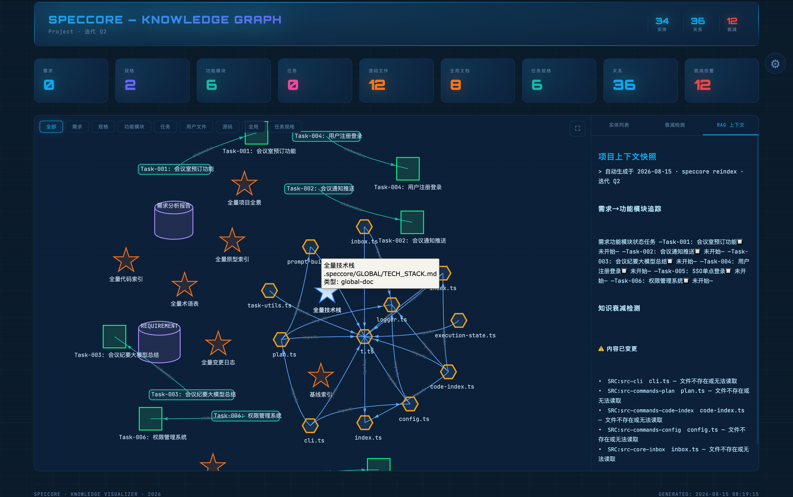
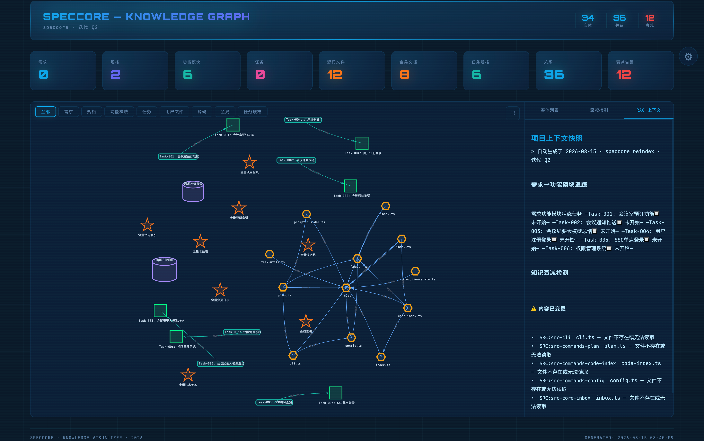

# SpecCore Overview

## What is it

SpecCore is a **spec-driven development CLI tool**. Core idea: **Code by Spec, Not by Vibe**.

- Auto-generates development specs from requirement documents
- AI-assisted requirement analysis, task splitting, execution planning
- Global dashboard tracks project health in real time
- Universal AI entry point (`ask`) auto-matches commands

## Core pipeline 🔒 AI commands

```
init → doc2spec → analyze(overview) → analyze(units) → split → plan → execute → pr → done
✅CLI   🔒AI      🔒AI                🔒AI            🔒AI   🔒AI   🔒AI    🔒AI  🔒AI
         ↑        ↑
         │        └── analyze each functional unit (REQ/TECH/TEST)
         └── generate iteration overview first (skeleton → complete)
```

**v8.3.177+ `analyze --scope=overview`**: before analyzing units one by one, the CLI scans `_matrix.md` metadata to generate an iteration-level overview (40-80 lines), giving the AI a global perspective and preventing it from getting lost in a sea of documents.

Each stage has a corresponding command, or you can use `@spec-ask "natural language"` in an AI IDE to advance automatically.

## Install

```bash
npm install -g speccore
speccore --version
```

## Three ways to use

### 1. Universal AI entry (recommended)
```bash
speccore ask "I want to build a login feature"
speccore ask "check project progress"
```

### 2. Single command

```bash
# ✅ CLI commands (typed directly in terminal)
speccore init
speccore dashboard --scope global

# 🔒 AI commands (use @spec-ask in an AI IDE)
@spec-ask "import PRD.docx to Q1"
```

### 3. Smart cascade 🔒 AI command
```bash
# In an AI IDE:
@spec-ask "run everything automatically"
```

## Key concepts

| Concept | Description |
|------|------|
| **Iteration** | Development iteration, e.g. Q1/Q2/Q3 |
| **Task** | Independent development task under an iteration |
| **Global layer** | Cross-project requirement index |
| **Spec** | Requirement specification documents |
| **Unified retrieval** | Doc RAG + code slices + knowledge graph, three sources merged into one retrieval system |
| **RAG index** | Title-chunked structured doc index, `.speccore/cache/rag-index*.json` |

## Retrieval commands (v6.8.0+)

```bash
# Refresh all retrieval layers at once (code index + doc RAG + knowledge graph)
speccore refresh
speccore refresh --code      # code index only
speccore refresh --rag       # doc RAG only
speccore refresh --graph     # knowledge graph only

# RAG index management
speccore rag-index                    # show all index file status
speccore rag-index --refresh --task Task-001   # incremental task index refresh
speccore rag-index --full --task Task-001      # full task index rebuild
```

The retrieval layer is built and refreshed automatically during the `analyze` stage; manual commands are for instant sync after you edit documents.

### 🧠 Knowledge graph visualization

`speccore knowledge` generates an interactive HTML knowledge graph:





## Output

| Command | Terminal output | AI output | HTML file |
|------|------|------|------|
| ask | Unicode box-drawing | HTML page | `speccore-ask-onboarding.html` / `speccore-ask-result.html` / `templates/html/speccore-ask-explain.html` |
| welcome | Unicode box-drawing | HTML page (color cards) | `welcome-project-{name}.html` |
| dashboard | text | HTML (Jira-standard 7-dimension) | `dashboard-iteration-{name}.html` (`--scope global` → `dashboard-project-{name}.html`) |
| dev | text | HTML (pipeline visualization) | `speccore-dev.html` |
| help | text | HTML help center | `templates/html/speccore-help.html` |
| knowledge | text | HTML (interactive graph) | `knowledge-graph-{iteration}.html` |
| retro | text | HTML review report | `templates/html/speccore-retro-T-001.html` |
| about | text | HTML about page | `speccore-about.html` |
| doc2spec | text | HTML requirement preview | `templates/html/speccore-ask-result.html` |
| spec2doc | text | HTML export preview | `templates/html/speccore-ask-result.html` |
